# Timeline Morpher — voice → schedule, for Masaro

A superintendent says *"rebar showed up late, we're two days behind on slab rebar…"* into their phone.
Seconds later the schedule has re-flowed: the delayed tasks turn red, the knock-on ripples down the
dependency graph, the new completion date is on screen, and every moved bar can be traced back to the
words that caused it. It works with **no API keys**, and it keeps working **offline**.

Built for the Masaro *"Voice-to-Schedule" Timeline Morpher* bounty on Node.

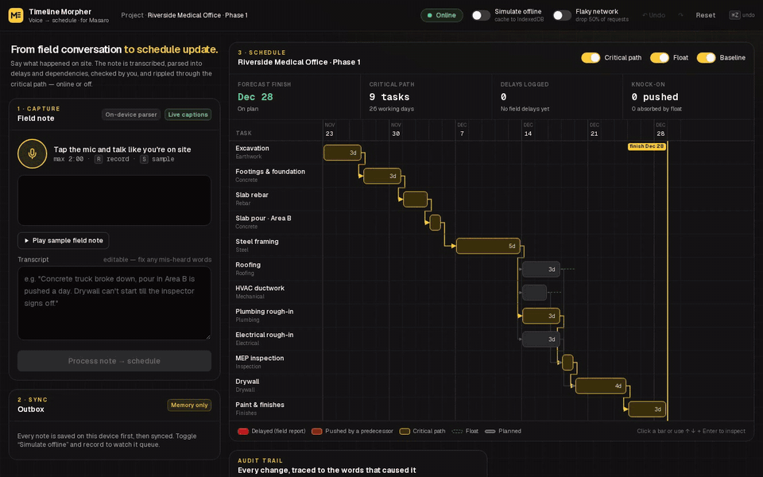

<sub>33 s, recorded automatically with `scripts/record-demo.mjs` · [MP4](docs/demo.mp4)</sub>

## How each requirement is met

| Bounty requirement | Where it lives | How it's proven |
|---|---|---|
| **Audio recorder** with a **real-time canvas waveform** and a **sample clip fallback** | `src/audio/recorder.ts` (MediaRecorder + AnalyserNode), `src/audio/waveform.ts` (rolling RMS bars + oscilloscope trace on `<canvas>`), `src/audio/useFieldCapture.ts` (capture state machine), `public/samples/field-note-riverside.mp3` (22 s field note with word timings for captions) | `mic.spec.ts` records from Chromium's fake mic and checks that the canvas has drawn pixels; `sample-flow.spec.ts` plays the clip and checks the captions stream in |
| **STT + LLM** parse messy notes into **JSON** of affected tasks, delays and dependencies | STT: browser Web Speech (live captions) → server Whisper (`/api/transcribe`) → type it yourself. LLM: `src/server/llmParser.ts`, any OpenAI-compatible provider. Rules: `src/parsing/localParser.ts`. Contract: `src/parsing/schema.ts` (Zod) | 127 unit tests, including the real Whisper transcript of the sample and a real Qwen2.5-3B response replayed in `llm-crosscheck.spec.ts` |
| **Interactive mini Gantt** where nodes **animate and turn red** on delays | `src/components/timeline/Gantt.tsx` (motion bars, dependency arrows, ripple staggered by graph depth), `src/domain/cpm.ts` (critical path) | `sample-flow.spec.ts` asserts `data-status="delayed"` and the computed red `rgb(185, 28, 28)`; screenshot 04 is taken mid-animation |
| **Offline toggle** that caches **audio in IndexedDB** and **auto-retries sync on reconnect** | `src/offline/syncEngine.ts` (outbox, backoff, single-flight), `idbStore.ts`, `network.ts` (simulated offline + flaky mode), `transport.ts` | `offline.spec.ts`: queue → reload (audio still there) → reconnect → auto-sync, oldest first; a 503 is retried with backoff; a 422 fails fast and can be retried by hand |

## What makes it more than the checklist

- **It does real schedule maths.** A forward/backward-pass critical path method on a working-day calendar gives float, the critical path and the *driving* predecessor of every task. So "electrical is 3 days behind" moves the finish date only if electrical has no float. The KPIs say how much the float soaked up.
- **Nothing touches the plan until a person approves it.** Every parse opens a review: each change shows its quote highlighted in the transcript, a confidence score, and editable task, days and lag fields. Raw Zod-validated JSON is one tab away. A live **schedule diff** ("Drywall Dec 23 → Jan 1, +7d, via Plumbing → MEP inspection") updates as you edit, and a ghost preview appears on the Gantt.
- **It doesn't blindly trust the LLM.** When an LLM is configured, its output is cross-checked against the deterministic parser (`src/parsing/reconcile.ts`):
  - Each change gets a badge: ✓ engines agree / ≠ engines differ / LLM only / rule engine only.
  - Quotes that aren't actually in the transcript are flagged, and their confidence is cut.
  - Anything the LLM missed is offered unticked.
  - On a disagreement, a one-click **"Use 0"** takes the rule engine's reading.

  This came from testing a free local model: Qwen2.5-3B invented a 3-day lag and missed the electrical delay. The review screen now makes both obvious (screenshot 11).
- **"Why did this move?"** Click any bar, or use the arrow keys and Enter. The inspector walks the cause chain back to the field note ("Drywall ← MEP inspection ← Plumbing rough-in ← *'plumbing can't start until the HVAC ductwork is in'*").
- **Recovery actions.** For critical tasks downstream of a delay, it tries crashing each one (more crew), re-runs the full CPM, and ranks the options by days recovered. "Try it" applies one; undo takes it back.
- **Undo/redo** (⌘/Ctrl+Z, 50 steps). The plan persists across reloads and is validated by re-running the CPM on load.
- **Built for the field.** Works one-handed on a phone; the timeline auto-scrolls to the first impacted bar. Keyboard shortcuts: R (record), S (sample). Supports reduced motion and has focus rings throughout. Recordings stop at 2 minutes to keep IndexedDB small.

## Screenshots

| | |
|---|---|
| 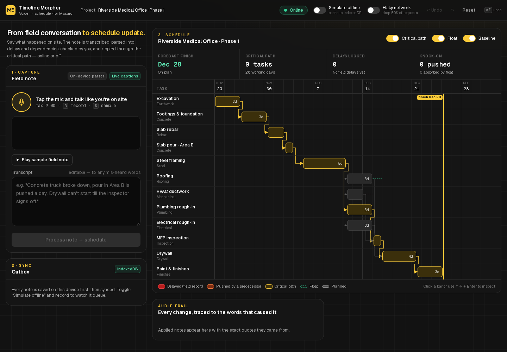 Overview: baseline plan | 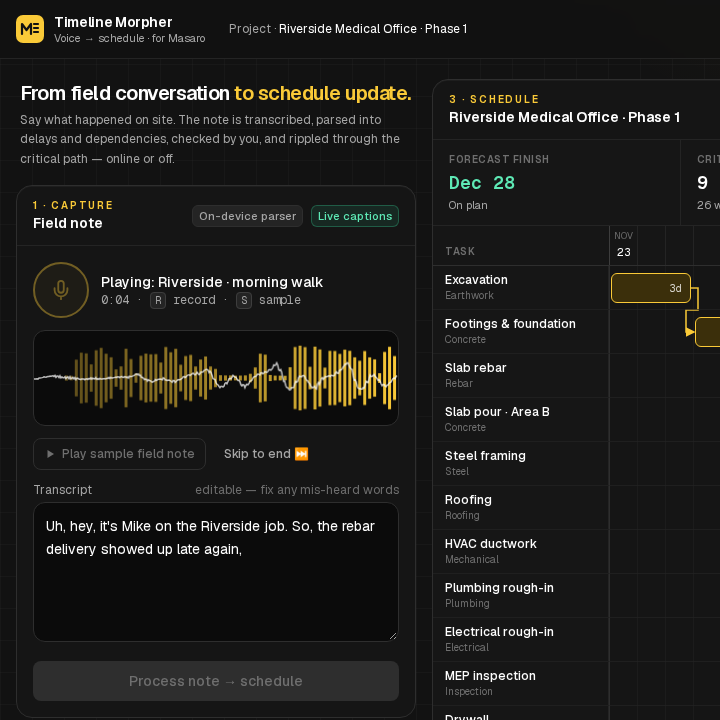 Sample clip: live waveform + captions |
| 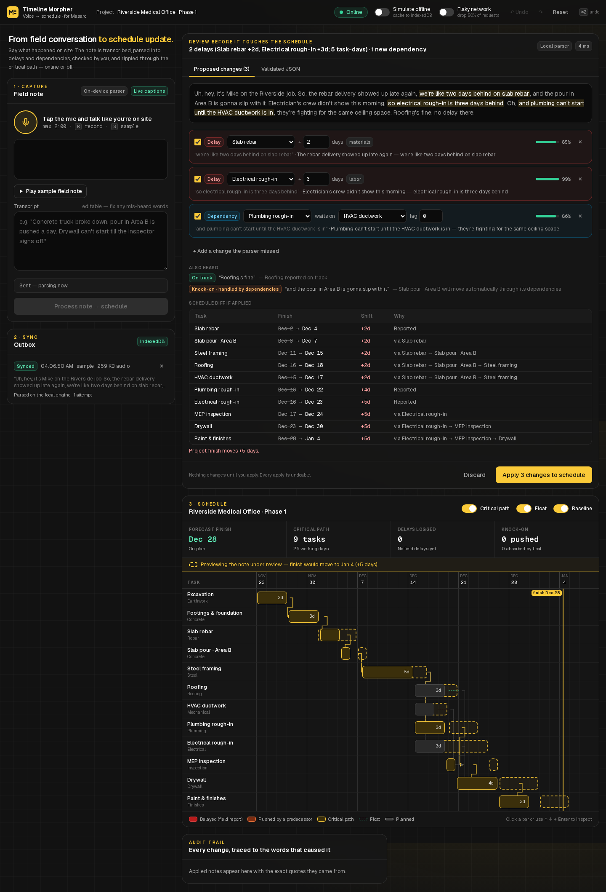 Review: quotes, confidence, schedule diff | 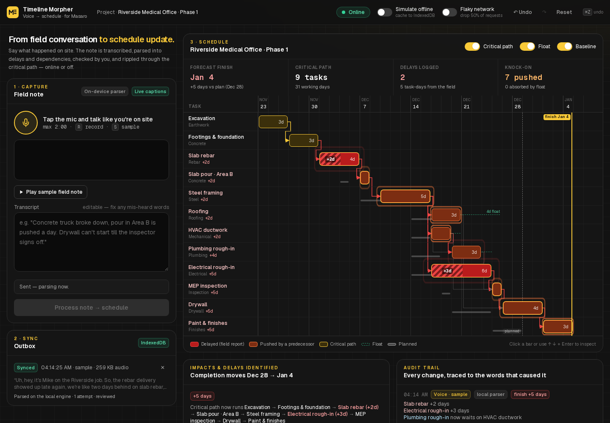 Ripple, captured mid-animation |
| 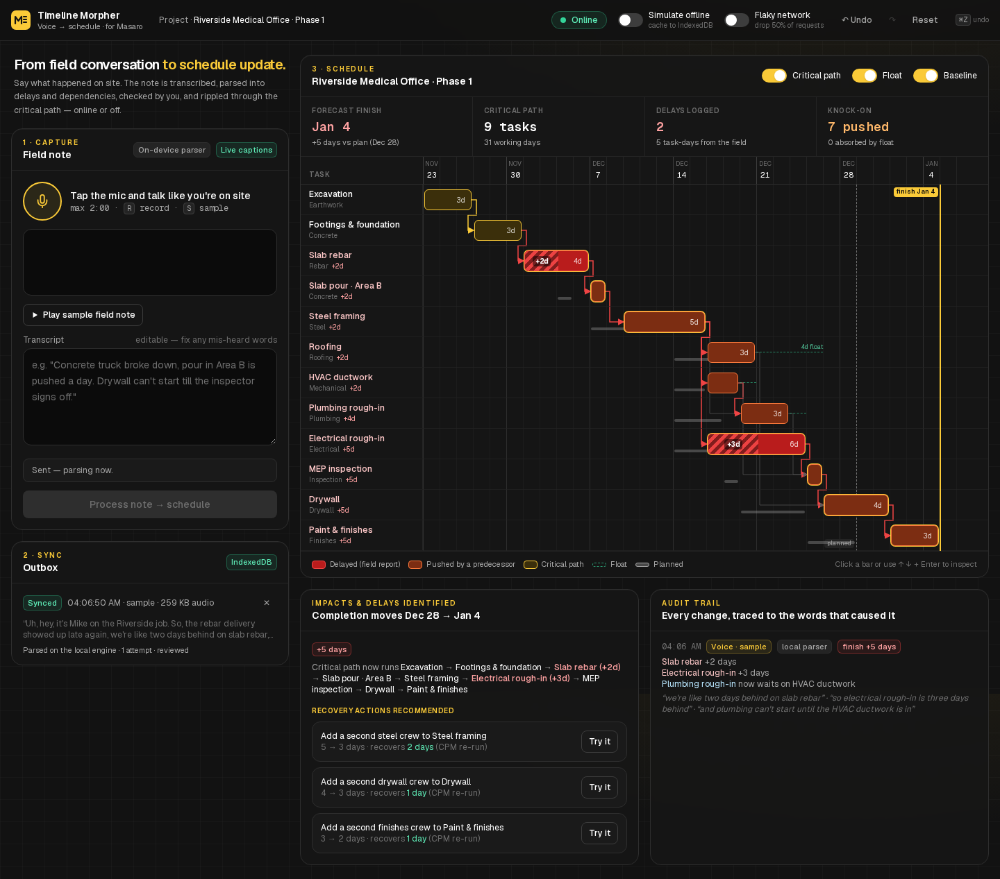 After apply: red = reported, rust = pushed | 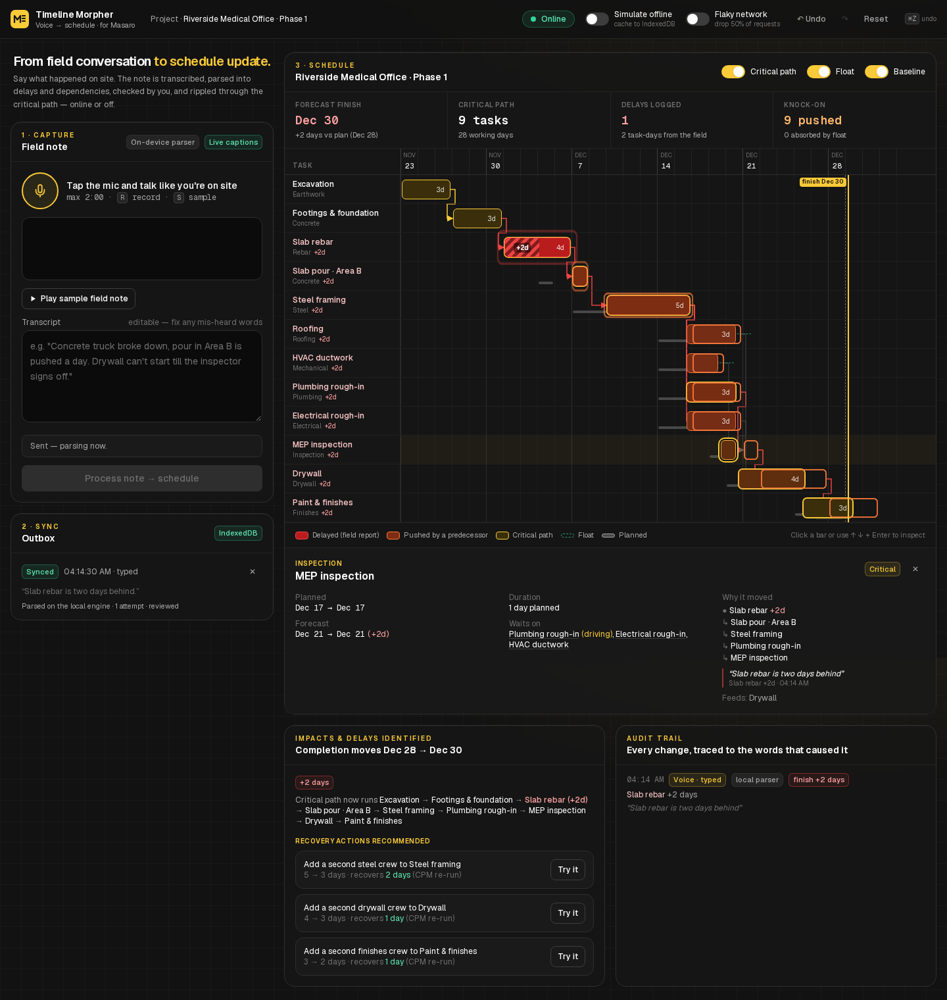 Inspector: cause chain back to the quote |
| 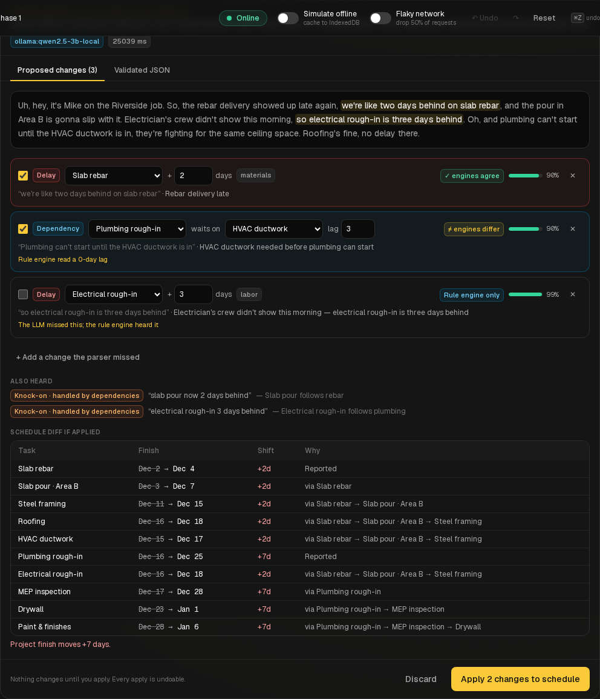 LLM cross-check (real Qwen2.5-3B output) | 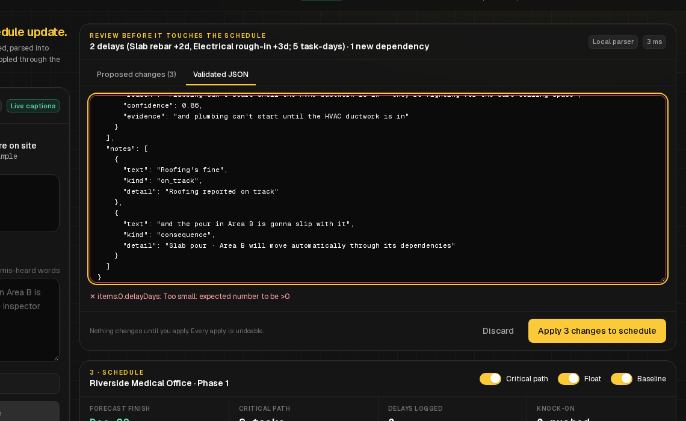 Editable JSON with Zod errors inline |
| 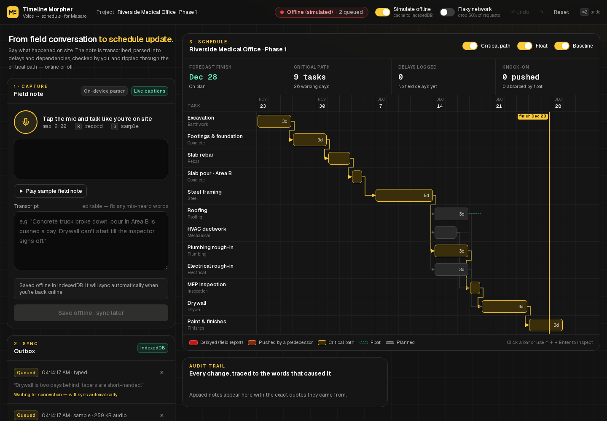 Offline: queued in IndexedDB | 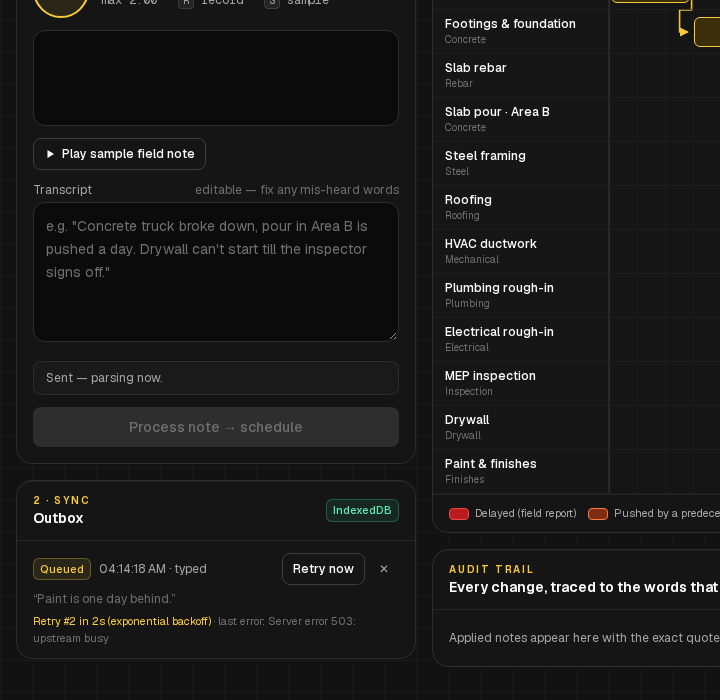 Server 503 → exponential backoff |
| 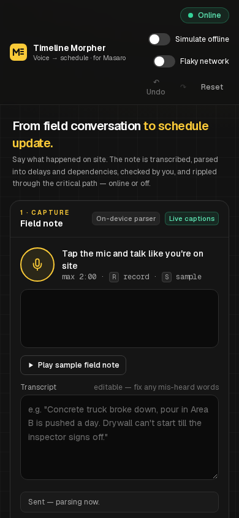 Mobile capture | 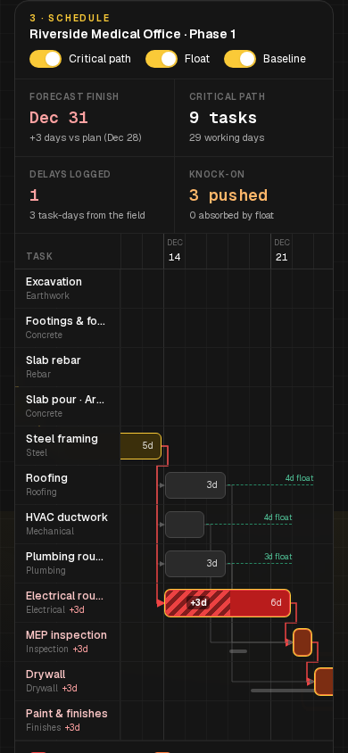 Mobile timeline, auto-scrolled to the delay |

## Run it

Requires Node 20+ and pnpm.

```bash
pnpm install
pnpm dev                 # http://localhost:3000 — no keys needed
```

```bash
pnpm test                # 127 unit tests (Vitest): parser, CPM, propagation, sync engine, IndexedDB, API routes
pnpm exec playwright install chromium
pnpm test:e2e            # 10 browser tests against a production build
pnpm check               # typecheck + lint + unit + build + e2e (same as CI)
```

### Optional AI providers (all free options)

Copy `.env.example` to `.env.local`. With nothing set, the app uses the browser's speech recognition and the on-device parser.

| What | Free option | Config |
|---|---|---|
| LLM, local | [Ollama](https://ollama.com) | `LLM_PROVIDER=ollama LLM_MODEL=qwen2.5:3b` |
| LLM, hosted | Gemini (AI Studio free tier), Groq, OpenRouter `:free` models | `LLM_PROVIDER=gemini LLM_API_KEY=…` |
| Speech-to-text, local | bundled `scripts/local-whisper-server.py` (faster-whisper) | `STT_PROVIDER=whisper-local` |
| Speech-to-text, hosted | Groq Whisper (free tier) | `STT_PROVIDER=groq STT_API_KEY=…` |

The Ollama and local-Whisper paths are verified end to end; the recorded model response is checked in under `tests/e2e/recorded/`. The hosted presets use each provider's documented OpenAI-compatible endpoint and go through the same client, but I didn't run them, since that needs keys.

Measured on an 8-core CPU box with no GPU:
- Whisper `base.en` transcribed the 22 s sample in about 0.8 s.
- Qwen2.5-3B (Ollama, GGUF Q4) parsed it in 21–38 s. That's why LLM requests have their own timeout and fall back to the rule engine instead of hanging the outbox.

## Architecture

```
 mic / sample clip ──► useFieldCapture ──► transcript (Web Speech | bundled captions | typed)
                                 │
                                 ▼
        IndexedDB outbox  ◄── SyncEngine.enqueue()      (saved locally FIRST, online or not)
                                 │  single-flight drain · FIFO · Web Locks across tabs
                                 │  backoff 1s→30s + jitter · 4xx = permanent · offline = pause
                                 ▼
   /api/transcribe (only if no text) ──► /api/parse  (Idempotency-Key → replay-safe)
                                            │
                     LLM (optional) ──► Zod ──► reconcile ◄── deterministic parser
                                            │       (fallback if LLM off / slow / invalid)
                                            ▼
                     Review: quotes · confidence · editable diff · JSON  ──► apply
                                            │
                                            ▼
         schedule store (undo/redo, persisted) ──► CPM ──► impact + cause chains ──► Gantt ripple
```

```
src/
  domain/     pure TS, no React: calendar, graph (topo sort, cycles), cpm, changes, impact, recovery
  parsing/    tokenizer, duration extraction, fuzzy task matcher, rule parser, Zod schema, reconcile
  server/     provider config, LLM client (fenced prompt, JSON mode, one repair round), idempotency cache
  offline/    outbox types, IndexedDB + memory stores, SyncEngine, NetworkMonitor, HTTP transport
  audio/      recorder, waveform renderer, Web Speech wrapper, sample clip, useFieldCapture
  state/      external stores (useSyncExternalStore), reducer with history, review draft logic
  components/ UI; timeline/ holds the Gantt, panel and inspector
```

Design decisions:
- **The domain layer is pure and has the most tests.** The Gantt is only a view of `computeSchedule()`; propagation is not animation logic. Every number on screen comes from the same CPM run that the tests check.
- **Outbox first, not "try the network, then cache".** Every note goes to IndexedDB before any request. Online and offline take the same path, so the offline mode isn't a separate, less-tested branch.
- **Two parsers, by design.** The rule parser runs in about 1 ms, is deterministic, and is always there as the fallback. The LLM handles phrasing the rules can't. Reconciling the two gives the reviewer something a single model can't: a reason to trust or doubt each line.
- **The transcript is untrusted input.** It's fenced in the prompt and length-capped (5,000 characters). Output is Zod-validated against the real task IDs; unknown IDs and self-dependencies are demoted to notes. Changes that would create cycles are rejected before they reach the plan.

### Edge cases handled

- Hedges ("maybe", "probably") lower confidence.
- Corrections ("two… actually three days") are flagged as ambiguous.
- Pronoun carry-over ("it's another day").
- "Half a day", "lost the morning", "rained out", "a couple of weeks", "36 hours".
- Speech-to-text mis-hearings ("dry wall", "h vac", "sparkies", "Roofings find").
- Knock-on mentions ("the pour will slip with it") are recognised as consequences, not double-counted.
- Duplicate links, dependency cycles, delays over 60 days, and unknown tasks are all rejected with a reason.
- Mic permission denied, no device, or device busy each get a specific message; autoplay blocked falls back to the transcript.
- IndexedDB unavailable (e.g. some private modes): falls back to an in-memory outbox and shows a badge saying so. Quota exceeded: a clear error, and the note stays in the editor.
- A tab closed mid-sync: stale "syncing" items are recovered.
- Two tabs open: Web Locks keep one drain at a time.
- Audio with no transcript and no server STT is parked as "needs transcript" with an inline fixer.
- Flaky-network mode drops 50% of requests.

## Tests

- **Unit (127, Vitest):**
  - CPM: float, critical path, lags, driving predecessor.
  - Calendar.
  - Change validation and impact / cause chains.
  - About 50 parser cases, including the real Whisper transcript.
  - Duration extraction and the fuzzy matcher.
  - Reconcile.
  - SyncEngine: FIFO, backoff, permanent vs transient errors, offline mid-sync, crash recovery, plus a real IndexedDB store via `fake-indexeddb`.
  - LLM client against a fake fetch: JSON repair, timeouts, fallback.
  - Reducer undo/redo, and the API routes (idempotent replay, 413/422).
- **E2E (10, Playwright, Chromium with a fake mic):**
  - Sample → parse → review → red nodes → undo.
  - Keyboard inspector, recovery, mobile layout.
  - Offline → reload → reconnect sync.
  - 503 backoff, 422 manual retry.
  - Mic waveform pixels, needs-transcript fixer.
  - LLM cross-check replay.

## Limitations and what I'd do next

- **One sample project.** A real version would load the project from Masaro's API; the parser already only uses the task names, IDs and aliases it's given.
- **Recovery suggestions are a single lever** (crashing a task to 65% of its duration). Real options include re-sequencing, overtime cost and crew availability.
- **No auth or multi-user conflict handling.** The idempotency cache is in-memory per server instance; production would use Redis or the database.
- **Small local models need the cross-check;** hosted models (Gemini Flash, Llama-3.3-70B) are noticeably more accurate.

## AI tools used

Built with an AI coding agent (Grok Bot) doing most of the typing, under my direction and review. I set the architecture, decided what to build and cut, and checked behaviour through the tests and by using the app. The ideas I'm proudest of — the outbox-first design, the LLM ↔ rules cross-check, and cause-chain tracing — came out of testing real failures, such as the 3B model's invented lag. Other tools: edge-tts for the sample voice note, Ollama + Qwen2.5-3B and faster-whisper to verify the AI paths for free.
